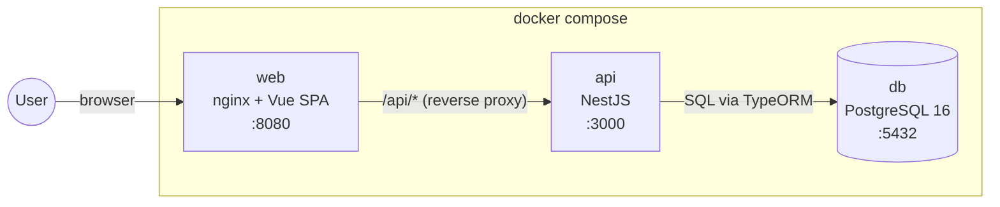

# 01 — Overview

## What this project is

A **full-stack web application** written entirely in **TypeScript**:

- a **backend API** built with **NestJS** that stores tasks in a **PostgreSQL** database, and
- a **frontend single-page application (SPA)** built with **Vue 3** that users interact with in the browser.

Users can create, list (with search, filter and pagination), edit, complete and delete tasks.
That is the "CRUD" part: **C**reate, **R**ead, **U**pdate, **D**elete.

The features are deliberately minimal. What makes this a _production-ready template_ is everything
around the features:

| Concern          | What is in place                                                                |
| ---------------- | ------------------------------------------------------------------------------- |
| Structure        | Monorepo, feature-based folders, clear layers                                   |
| Type safety      | TypeScript strict mode end to end                                               |
| Input validation | Every request validated by DTOs before reaching business logic                  |
| Configuration    | Environment variables validated at startup — the app refuses to boot if invalid |
| Database         | Versioned schema migrations, never automatic schema sync                        |
| Security         | Security headers, CORS allow-list, rate limiting, safe error messages           |
| Observability    | Structured JSON logs, health-check endpoint                                     |
| Documentation    | Auto-generated OpenAPI/Swagger docs                                             |
| Tests            | Unit, end-to-end (API) and component/store (web) tests                          |
| Code quality     | Linting, formatting, pre-commit hooks                                           |
| Packaging        | Small, secure Docker images; one command to run the whole stack                 |
| Automation       | CI pipeline that runs every check on every push                                 |

## The big picture

1. The browser loads the Vue app (static HTML/JS/CSS) from **nginx**.
2. The Vue app calls `/api/v1/tasks`. nginx forwards anything under `/api/` to the **NestJS API**.
3. The API validates the request, runs business logic and talks to **PostgreSQL**.
4. JSON flows back the same way.

In development you don't use nginx: **Vite**'s dev server serves the Vue app with hot reload and
proxies `/api` to the API running locally (see [Architecture](02-architecture.md#development-vs-production)).

## Technology stack and why each piece was chosen

### Language

| Tech           | Version | Why                                                                                                                                                                                               |
| -------------- | ------- | ------------------------------------------------------------------------------------------------------------------------------------------------------------------------------------------------- |
| **TypeScript** | 5.9     | JavaScript with types. Catches whole classes of bugs at compile time, enables autocompletion and safe refactoring. One language for frontend and backend means shared knowledge and mental model. |
| **Node.js**    | 22 LTS  | Runtime for the backend and all tooling. "LTS" (Long Term Support) versions get security fixes for ~3 years, which is what production uses.                                                       |

### Backend

| Tech                                           | Why                                                                                                                                                                                             |
| ---------------------------------------------- | ----------------------------------------------------------------------------------------------------------------------------------------------------------------------------------------------- |
| **NestJS 11**                                  | An opinionated framework on top of Express. Gives you modules, dependency injection, decorators and a standard structure — so every Nest project looks alike, which is exactly what teams want. |
| **Express 5** (via `@nestjs/platform-express`) | The underlying HTTP server. Nest abstracts it, but it's there.                                                                                                                                  |
| **TypeORM 0.3**                                | ORM (Object-Relational Mapper): maps TypeScript classes to database tables. First-class Nest integration and migrations.                                                                        |
| **PostgreSQL 16**                              | The most capable open-source relational database. Reliable, standard SQL, great tooling. Default choice for most new products.                                                                  |
| **class-validator / class-transformer**        | Declarative validation using decorators on DTO classes (`@IsString()`, `@MaxLength(120)`).                                                                                                      |
| **Joi**                                        | Validates environment variables at startup.                                                                                                                                                     |
| **@nestjs/config**                             | Loads `.env` files and exposes typed configuration via dependency injection.                                                                                                                    |
| **@nestjs/swagger**                            | Generates OpenAPI documentation and an interactive UI from your code.                                                                                                                           |
| **helmet**                                     | Sets HTTP security headers.                                                                                                                                                                     |
| **compression**                                | Gzips responses to reduce bandwidth.                                                                                                                                                            |
| **@nestjs/throttler**                          | Rate limiting (protects against brute force and abuse).                                                                                                                                         |
| **nestjs-pino / pino**                         | Very fast structured (JSON) logging with per-request context.                                                                                                                                   |
| **@nestjs/terminus**                           | Health checks (`/api/health`) used by Docker and orchestrators.                                                                                                                                 |

### Frontend

| Tech             | Why                                                                                                           |
| ---------------- | ------------------------------------------------------------------------------------------------------------- |
| **Vue 3.5**      | Progressive UI framework. Composition API + `<script setup>` is the modern, officially recommended style.     |
| **Vite 7**       | Build tool and dev server. Near-instant startup and hot module replacement (HMR); produces optimised bundles. |
| **Pinia 3**      | Official Vue state management library (successor of Vuex). Simple, typed, devtools support.                   |
| **Vue Router 4** | Official router: maps URLs to views, supports lazy loading.                                                   |
| **Axios**        | HTTP client with interceptors (central place for error handling and, later, auth tokens).                     |
| **vue-tsc**      | Type-checks `.vue` files (the normal `tsc` can't).                                                            |

### Testing

| Tech                        | Where | Why                                                             |
| --------------------------- | ----- | --------------------------------------------------------------- |
| **Jest 30**                 | API   | Nest's default test runner.                                     |
| **Supertest**               | API   | Sends real HTTP requests to the app in tests.                   |
| **Vitest 3**                | Web   | Vite-native test runner, Jest-compatible API, very fast.        |
| **@vue/test-utils + jsdom** | Web   | Mount components and interact with them in a simulated browser. |

### Tooling & infrastructure

| Tech                             | Why                                                                                                 |
| -------------------------------- | --------------------------------------------------------------------------------------------------- |
| **npm workspaces**               | Manage two apps in one repo with a single install and lockfile. No extra tool required.             |
| **ESLint 9 + typescript-eslint** | Finds bugs and bad patterns in code.                                                                |
| **Prettier 3**                   | Formats code automatically so style is never discussed in reviews.                                  |
| **Husky + lint-staged**          | Runs lint and format on staged files before each commit.                                            |
| **Docker + docker compose**      | Packages each service into an image; runs the whole stack with one command, identically everywhere. |
| **nginx**                        | Serves the built frontend and reverse-proxies the API in production.                                |
| **GitHub Actions**               | CI: runs all checks on every push and pull request.                                                 |

## Key design decisions (summary)

These are explained in detail in [Architecture](02-architecture.md):

1. **Monorepo** — frontend and backend change together; one PR can update both sides of an API change.
2. **Feature-first folders** — code is grouped by business domain (`tasks/`), not by technical type.
3. **Thin layers with single responsibilities** — controllers ↔ HTTP, services ↔ logic, repositories ↔ data.
4. **Validate at boundaries** — request bodies, query strings and environment variables are all validated.
5. **Schema via migrations only** — the database structure is versioned code, reviewed like any other change.
6. **Same-origin in production** — nginx serves both the UI and `/api`, so the browser never makes cross-origin calls.
7. **Fail fast** — invalid config stops the app at boot instead of failing mysteriously later.
