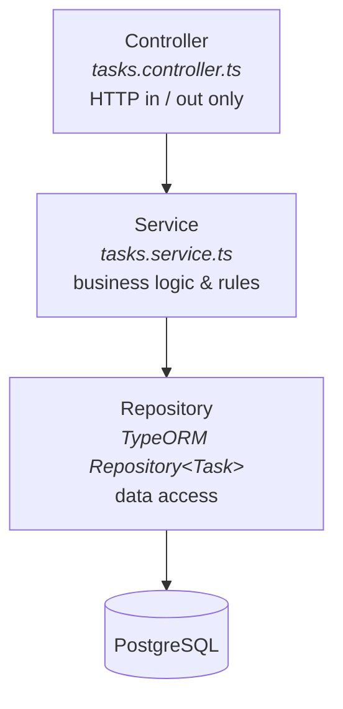
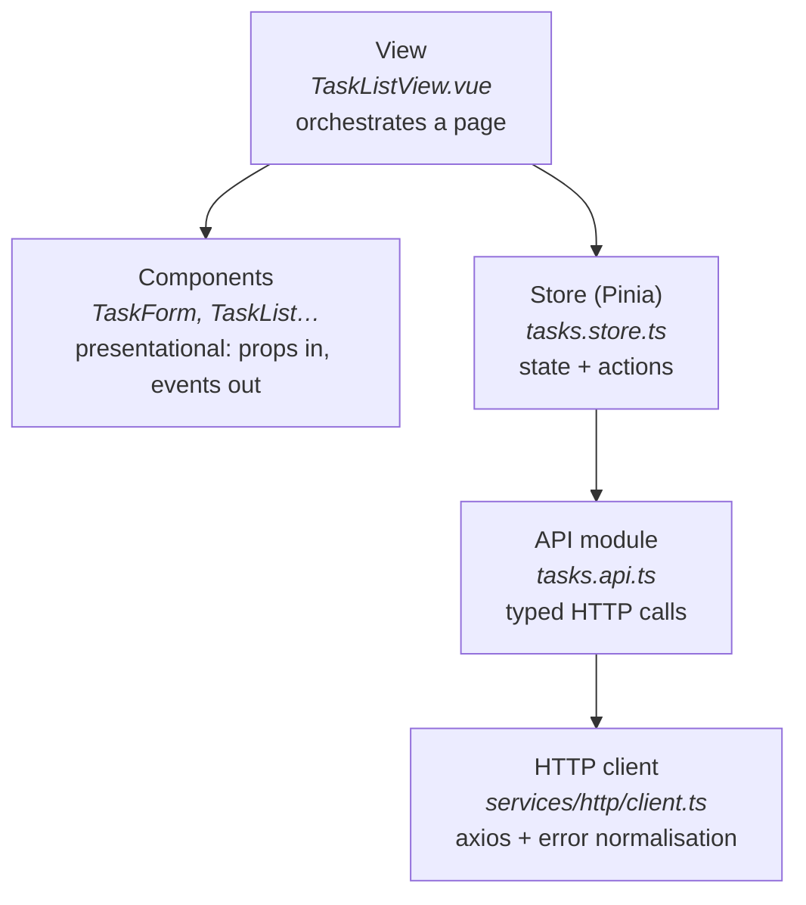
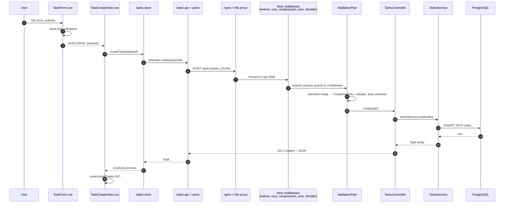
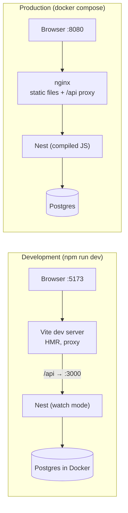

# 02 — Architecture

This document explains **how the system is shaped and why**. Once you understand these ideas,
every file in the repo will make sense.

## 1. Monorepo with npm workspaces

A **monorepo** is a single Git repository containing several projects. Here:

```
fullstack-crud/            ← root workspace (shared tooling only)
├── apps/api/              ← workspace "@app/api"  (NestJS)
└── apps/web/              ← workspace "@app/web"  (Vue)
```

The root [`package.json`](../package.json) declares `"workspaces": ["apps/*"]`. Running
`npm install` at the root:

- installs dependencies for **all** apps in one go,
- **hoists** shared packages (e.g. `typescript`) into the root `node_modules`,
- writes **one** `package-lock.json` for the whole repo (reproducible installs).

Run a script in one workspace with `-w`: `npm test -w @app/web`. Root scripts like `npm run build`
run `build` in every workspace (`--workspaces`).

**Why a monorepo?**

| Benefit           | Example                                                              |
| ----------------- | -------------------------------------------------------------------- |
| Atomic changes    | Add a field to the API DTO _and_ the web type in the same commit/PR. |
| One tooling setup | Prettier, Husky, CI, editor settings are shared.                     |
| Simple onboarding | `git clone` + `npm install` and you have everything.                 |

**Trade-off:** in very large organisations a monorepo needs build caching tools (Nx, Turborepo).
For two apps, plain npm workspaces is the simplest correct choice.

## 2. The layered architecture

Both apps split code into **layers**, each with one responsibility. A layer only talks to the
layer directly below it.

### Backend layers



| Layer      | Knows about                          | Must NOT know about           |
| ---------- | ------------------------------------ | ----------------------------- |
| Controller | URLs, HTTP verbs, status codes, DTOs | SQL, repositories             |
| Service    | Business rules, entities             | HTTP request/response objects |
| Repository | Tables, queries                      | HTTP, business rules          |

**Why?** Each piece is small, testable in isolation (we mock the layer below), and replaceable.
You could expose the same service through a CLI or a message queue without touching it.

### Frontend layers



- **Components** don't fetch data. They receive props and emit events. That makes them reusable
  and easy to test.
- **Views** connect components to the store.
- **Stores** hold state (`items`, `loading`, `error`) and call the API module.
- **API modules** know endpoints and types, nothing about UI.
- **The HTTP client** is configured once (base URL, timeout, error handling).

## 3. Feature-first organisation

Code is grouped by **business feature**, not by technical type.

```
❌ by type (scales badly)          ✅ by feature (this repo)
controllers/tasks.controller.ts     modules/tasks/tasks.controller.ts
controllers/users.controller.ts     modules/tasks/tasks.service.ts
services/tasks.service.ts           modules/tasks/dto/...
services/users.service.ts           modules/users/...
```

With feature folders, everything about "tasks" lives in one place. Adding a feature means adding
a folder; deleting a feature means deleting a folder. Code shared by several features is
**promoted** to `common/` (API) or `components/`, `services/`, `types/` (web) — but only once a
second feature actually needs it (avoid premature abstraction).

## 4. Request lifecycle (end to end)

What happens when a user clicks **Create task**:



If anything fails (invalid input → 400, unknown id → 404, crash → 500), the
**`AllExceptionsFilter`** turns the error into a consistent JSON body, axios's interceptor turns
that into an **`ApiError`**, and the store exposes it as `store.error`, which the view displays.
See [Observability](10-observability.md#error-handling-end-to-end).

## 5. Development vs production



In both cases the browser calls a **relative** URL (`/api/v1/...`) on the **same origin** it was
loaded from. A proxy (Vite in dev, nginx in prod) forwards it to the API. Benefits:

- The frontend build doesn't hard-code the API host.
- No CORS preflight requests in production (same origin).
- The API port never needs to be public; only nginx is exposed in a real deployment.

## 6. API design principles

- **REST resources** with plural nouns: `/tasks`, `/tasks/:id`.
- **HTTP verbs carry meaning**: `GET` read, `POST` create, `PATCH` partial update, `DELETE` remove.
- **Correct status codes**: `201` created, `204` no content on delete, `400` invalid, `404` not found.
- **Versioning in the URL**: `/api/v1/...`. A breaking change becomes `/api/v2/...` while v1 keeps working.
- **Pagination** on list endpoints with a standard envelope `{ data, meta }`.
- **One error shape** for every error.
- **UUID ids** — not guessable, safe to generate anywhere.

## 7. Cross-cutting design principles

| Principle                   | Where you see it                                                                                                 |
| --------------------------- | ---------------------------------------------------------------------------------------------------------------- |
| **Single Responsibility**   | Each file/class does one thing (controller vs service vs DTO).                                                   |
| **Dependency Injection**    | Nest injects `Repository<Task>` into the service; tests inject mocks instead.                                    |
| **Fail fast**               | Joi env validation stops boot; `getOrThrow` throws if config is missing.                                         |
| **Validate at boundaries**  | DTOs for HTTP input, Joi for env, TypeScript everywhere in between.                                              |
| **Configuration over code** | Ports, DB credentials, CORS origins, log level come from env vars.                                               |
| **Twelve-Factor App**       | Config in env, stateless processes, logs to stdout, dev/prod parity via Docker.                                  |
| **Least privilege**         | Containers run as non-root; unknown request fields are rejected.                                                 |
| **Single source of truth**  | `buildTypeOrmOptions` is used by both the app and the migration CLI; `setupApp` by both `main.ts` and e2e tests. |

The [Twelve-Factor App](https://12factor.net) methodology is worth reading in full — most of
this repo's infrastructure choices follow it.
