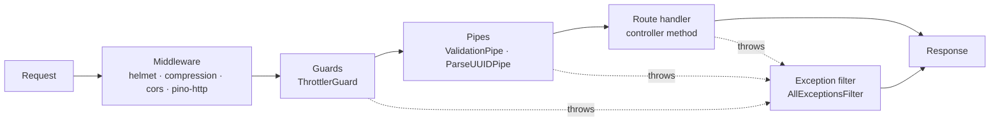

# 04 — Backend (NestJS)

This document teaches the NestJS concepts used in [`apps/api`](../apps/api/) using the real code.

## 1. What NestJS gives you

Plain Express lets you write `app.get('/tasks', handler)` and organise things however you like.
That freedom becomes chaos in a team. **NestJS** adds a standard structure:

| Concept                       | One-line meaning                                                   |
| ----------------------------- | ------------------------------------------------------------------ |
| **Module**                    | A box grouping related controllers and providers                   |
| **Provider**                  | Any class Nest can create and inject (services, repositories, …)   |
| **Dependency Injection (DI)** | Nest creates objects and passes them to constructors for you       |
| **Controller**                | Maps HTTP routes to methods                                        |
| **DTO**                       | Class describing the shape of incoming data, with validation rules |
| **Pipe**                      | Transforms/validates input before the handler runs                 |
| **Guard**                     | Decides whether a request may proceed (auth, rate limit)           |
| **Filter**                    | Turns thrown exceptions into HTTP responses                        |
| **Middleware**                | Express-style functions run on every request (helmet, compression) |
| **Decorator**                 | `@Something()` annotations that attach metadata to classes/methods |

### Decorators and metadata

Decorators like `@Controller('tasks')` or `@IsString()` don't run your logic directly — they
**attach metadata** to the class. Nest (and class-validator, TypeORM, Swagger) read that metadata
at runtime. This requires two TypeScript options in
[`tsconfig.json`](../apps/api/tsconfig.json): `experimentalDecorators` and
`emitDecoratorMetadata`, plus `import 'reflect-metadata'` (Nest does this for you).

`emitDecoratorMetadata` is how DI works: TypeScript emits the **types of constructor
parameters**, so Nest knows that `TasksController` needs a `TasksService`.

## 2. Request pipeline order

Every request goes through these stages in this order:



(Nest also has **interceptors** around the handler — not used here yet; typical uses are
response mapping, caching and timing.)

## 3. Bootstrapping: `main.ts` and `app.setup.ts`

[`main.ts`](../apps/api/src/main.ts) is intentionally tiny:

```ts
const app = await NestFactory.create(AppModule, { bufferLogs: true });
app.useLogger(app.get(Logger)); // use pino for Nest's own logs
setupApp(app); // all global configuration
await app.listen(port);
```

- `bufferLogs: true` holds early log lines until the pino logger is attached, so _all_ logs are
  structured JSON.
- All global configuration lives in [`app.setup.ts`](../apps/api/src/app.setup.ts) — **not** in
  `main.ts` — because the e2e tests call the same `setupApp()`. Tests therefore exercise exactly
  the production pipeline (prefix, validation, error format…). This is a very common bug source
  in real projects when skipped.

What `setupApp` does:

| Line                                                   | Effect                                                  |
| ------------------------------------------------------ | ------------------------------------------------------- |
| `setGlobalPrefix('api')`                               | Every route starts with `/api`                          |
| `enableVersioning({ type: URI, defaultVersion: '1' })` | Adds `/v1` → `/api/v1/tasks`                            |
| `app.use(helmet())`                                    | Security headers ([09-security](09-security.md))        |
| `app.use(compression())`                               | Gzip responses                                          |
| `enableCors({ origin: corsOrigins, … })`               | Only listed origins may call the API from a browser     |
| `useGlobalPipes(new ValidationPipe({...}))`            | Validate every DTO (see §6)                             |
| `useGlobalFilters(new AllExceptionsFilter())`          | Uniform error JSON                                      |
| `enableShutdownHooks()`                                | On `SIGTERM` (Docker stop) close DB connections cleanly |
| `SwaggerModule.setup('api/docs', …)`                   | Interactive API docs, when enabled                      |

## 4. Modules

[`app.module.ts`](../apps/api/src/app.module.ts) is the **composition root** — it only wires
things together:

```ts
@Module({
  imports: [
    ConfigModule.forRoot({...}),    // infrastructure
    LoggerModule.forRootAsync({...}),
    ThrottlerModule.forRootAsync({...}),
    DatabaseModule,
    HealthModule,                   // features
    TasksModule,
  ],
  providers: [{ provide: APP_GUARD, useClass: ThrottlerGuard }],
})
export class AppModule {}
```

- **`forRoot` / `forRootAsync`**: "dynamic modules" that take configuration. The `Async` variant
  uses `useFactory` + `inject: [ConfigService]` so configuration is read from validated config
  rather than hard-coded.
- **`APP_GUARD`**: registers a guard globally (every route gets rate limiting).

A **feature module** ([`tasks.module.ts`](../apps/api/src/modules/tasks/tasks.module.ts)):

```ts
@Module({
  imports: [TypeOrmModule.forFeature([Task])],  // makes Repository<Task> injectable here
  controllers: [TasksController],
  providers: [TasksService],
  exports: [TasksService],                      // other modules may import & use it
})
```

Modules are **encapsulated**: a provider is only visible inside its module unless exported.
That keeps features independent.

## 5. Dependency injection in practice

```ts
@Injectable()
export class TasksService {
  constructor(
    @InjectRepository(Task)
    private readonly tasksRepository: Repository<Task>,
  ) {}
}

@Controller({ path: 'tasks', version: '1' })
export class TasksController {
  constructor(private readonly tasksService: TasksService) {}
}
```

You never write `new TasksService(...)`. Nest builds a graph of dependencies, creates each
provider **once** (singleton by default) and passes it where needed.

The pay-off is testing: in
[`tasks.service.spec.ts`](../apps/api/src/modules/tasks/tasks.service.spec.ts) we provide a fake
repository under the same token:

```ts
Test.createTestingModule({
  providers: [TasksService, { provide: getRepositoryToken(Task), useValue: repo }],
});
```

> **Gotcha:** for DI to work, the injected class must be imported as a **value**
> (`import { TasksService }`), not `import type`, because decorator metadata needs the real class
> at runtime. That's why the lint config doesn't force `import type` everywhere.

## 6. DTOs and validation

A **DTO (Data Transfer Object)** describes the data that crosses the API boundary.
[`create-task.dto.ts`](../apps/api/src/modules/tasks/dto/create-task.dto.ts):

```ts
export class CreateTaskDto {
  @Transform(trim) // "  Buy milk " → "Buy milk"
  @IsString()
  @IsNotEmpty()
  @MaxLength(120)
  title: string;

  @IsOptional()
  @IsEnum(TaskStatus)
  status?: TaskStatus;

  @IsOptional()
  @IsDateString({ strict: true })
  dueDate?: string | null;
}
```

The global `ValidationPipe` options matter a lot:

| Option                       | Effect                                                                                                                   | Why                                                                      |
| ---------------------------- | ------------------------------------------------------------------------------------------------------------------------ | ------------------------------------------------------------------------ |
| `transform: true`            | Converts the plain JSON into a `CreateTaskDto` instance; converts query strings `"2"` → `2` (with `@Type(() => Number)`) | Handlers receive real types                                              |
| `whitelist: true`            | Strips properties without decorators                                                                                     | Prevents **mass assignment** (e.g. a client setting `id` or `createdAt`) |
| `forbidNonWhitelisted: true` | Instead of silently stripping, returns 400 listing the unknown fields                                                    | Clients learn about mistakes immediately                                 |

Other DTO patterns used:

- **`UpdateTaskDto extends PartialType(CreateTaskDto)`** — all fields optional, same rules, zero
  duplication. Imported from `@nestjs/swagger` so the docs reflect it too.
- **`QueryTaskDto extends PaginationQueryDto`** — every list endpoint gets `page` & `limit`
  validation (1–100) for free.
- **Response DTOs** ([`task-response.dto.ts`](../apps/api/src/modules/tasks/dto/task-response.dto.ts))
  exist only to describe responses in Swagger.
- **Barrel file** `dto/index.ts` re-exports all DTOs: `import { CreateTaskDto, QueryTaskDto } from './dto'`.

## 7. Controllers

[`tasks.controller.ts`](../apps/api/src/modules/tasks/tasks.controller.ts) only translates HTTP:

```ts
@Get(':id')
@ApiOkResponse({ type: TaskResponseDto })
@ApiNotFoundResponse({ description: 'Task not found' })
findOne(@Param('id', ParseUUIDPipe) id: string): Promise<Task> {
  return this.tasksService.findOne(id);
}

@Delete(':id')
@HttpCode(HttpStatus.NO_CONTENT)
remove(@Param('id', ParseUUIDPipe) id: string): Promise<void> {
  return this.tasksService.remove(id);
}
```

- `@Param('id', ParseUUIDPipe)` rejects `/tasks/abc` with 400 before touching the DB.
- `@Body()`, `@Query()` combined with DTO types trigger validation.
- Return values are serialised to JSON automatically. Returning a Promise is fine.
- `@Api*` decorators feed Swagger.

## 8. Services

[`tasks.service.ts`](../apps/api/src/modules/tasks/tasks.service.ts) holds the logic:

```ts
async findAll(query: QueryTaskDto): Promise<PaginatedResponseDto<Task>> {
  const { page, limit, status, search } = query;
  const where: FindOptionsWhere<Task> = {};
  if (status) where.status = status;
  if (search) where.title = ILike(`%${search}%`);   // parameterised, case-insensitive

  const [items, total] = await this.tasksRepository.findAndCount({
    where, order: { createdAt: 'DESC' }, skip: (page - 1) * limit, take: limit,
  });
  return PaginatedResponseDto.of(items, total, page, limit);
}

async findOne(id: string): Promise<Task> {
  const task = await this.tasksRepository.findOneBy({ id });
  if (!task) throw new NotFoundException(`Task with id "${id}" not found`);
  return task;
}
```

Rules followed:

- Throw **Nest HTTP exceptions** (`NotFoundException`, `ConflictException`…) for expected
  failures. The filter maps them to status codes.
- `update` and `remove` reuse `findOne`, so "not found" behaviour is consistent.
- `merge` + `save` for updates so TypeORM runs hooks and updates `updated_at`.

## 9. Shared building blocks (`common/`)

| File                                                                                  | Purpose                                                                                                                                                                                    |
| ------------------------------------------------------------------------------------- | ------------------------------------------------------------------------------------------------------------------------------------------------------------------------------------------ |
| [`base.entity.ts`](../apps/api/src/common/entities/base.entity.ts)                    | Abstract class: UUID `id`, `created_at`, `updated_at` (timestamptz). Every entity extends it.                                                                                              |
| [`pagination-query.dto.ts`](../apps/api/src/common/dto/pagination-query.dto.ts)       | `page` (≥1, default 1), `limit` (1–100, default 10)                                                                                                                                        |
| [`paginated-response.dto.ts`](../apps/api/src/common/dto/paginated-response.dto.ts)   | `{ data, meta: { page, limit, total, totalPages } }` with a static `of()` factory                                                                                                          |
| [`all-exceptions.filter.ts`](../apps/api/src/common/filters/all-exceptions.filter.ts) | Catches _everything_ and returns `{ statusCode, error, message, path, timestamp }`. Unknown errors become a generic 500 and are logged with stack trace — internals never leak to clients. |

## 10. Configuration module

See [Configuration](08-configuration.md) for the full story. In short:

```ts
ConfigModule.forRoot({
  isGlobal: true, // inject ConfigService anywhere without importing the module
  cache: true, // read process.env once
  load: [appConfig, databaseConfig], // typed namespaces
  validationSchema: envValidationSchema, // Joi
  validationOptions: { abortEarly: false }, // report ALL invalid vars at once
});
```

Consumers read typed config with `config.getOrThrow<AppConfig>('app')`.

## 11. Logging, health, rate limiting, Swagger

- **Logging** — `nestjs-pino` ([10-observability](10-observability.md)). Pretty single-line logs
  in dev, JSON in production, auth headers/cookies redacted, `/health` requests not logged.
- **Health** — [`health.controller.ts`](../apps/api/src/modules/health/health.controller.ts):
  Terminus pings the DB. `VERSION_NEUTRAL` makes it `/api/health` (no `/v1`), and `@SkipThrottle()`
  exempts it from rate limiting so monitors never get 429.
- **Rate limiting** — `ThrottlerModule` configured from `THROTTLE_TTL`/`THROTTLE_LIMIT` (default
  100 requests / 60 s per IP), applied globally through `APP_GUARD`.
- **Swagger** — `nest-cli.json` enables the Swagger **compiler plugin** with
  `classValidatorShim` and `introspectComments`: DTO properties, validation constraints and JSDoc
  comments (`/** @example "Write the README" */`) appear in the docs automatically. UI at
  `/api/docs`, disabled by default in production (`SWAGGER_ENABLED`).

## 12. Build and run

| Command                          | What happens                                            |
| -------------------------------- | ------------------------------------------------------- |
| `npm run start:dev -w @app/api`  | `nest start --watch`: compile + restart on change       |
| `npm run build -w @app/api`      | `nest build` → compiles `src/` to `dist/` (CommonJS JS) |
| `npm run start:prod -w @app/api` | `node dist/main` — what the Docker image runs           |

TypeScript is compiled with `module: nodenext`, which emits CommonJS because the API's
`package.json` has no `"type": "module"`. Nest's ecosystem is still mostly CommonJS, so this is
the safest production choice.

## 13. Adding a new backend feature (summary)

1. Create `src/modules/<plural>/` mirroring `tasks/`.
2. Entity extending `BaseEntity` + a **migration** ([05-database](05-database.md)).
3. DTOs with validation; service; controller; module.
4. Register in `app.module.ts`.
5. Unit + e2e tests.

The full walkthrough is in [Development workflow](15-development-workflow.md#adding-a-new-feature-end-to-end).
