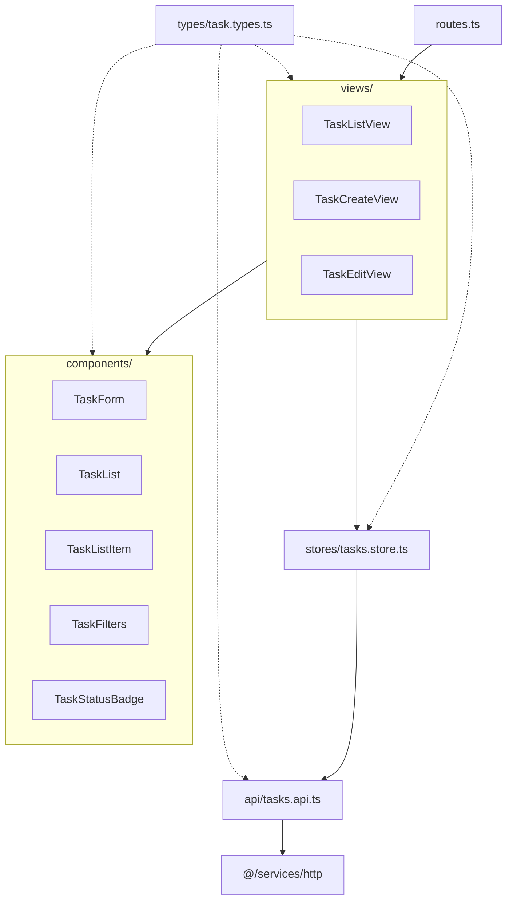

# 06 — Frontend (Vue 3)

This document explains [`apps/web`](../apps/web/): how the Vue application is built, organised
and connected to the API.

## 1. What a SPA is

A **Single-Page Application** loads one HTML page ([`index.html`](../apps/web/index.html)) and a
JavaScript bundle. After that, navigating between "pages" happens in the browser — the router
swaps components without reloading. Data is fetched as JSON from the API.

Consequence for hosting: the server must return `index.html` for _any_ unknown path (e.g.
`/tasks/123/edit`), so the router can handle it. That's the `try_files … /index.html` line in
[`nginx.conf`](../apps/web/nginx.conf).

## 2. Vite: dev server and build tool

[`vite.config.ts`](../apps/web/vite.config.ts):

```ts
plugins: [vue()],                                  // compiles .vue files
resolve: { alias: { '@': './src' } },              // import '@/services/http'
server: {
  port: 5173,
  proxy: { '/api': { target: env.VITE_DEV_API_PROXY_TARGET ?? 'http://localhost:3000' } },
},
build: { target: 'es2022', sourcemap: mode !== 'production' },
```

- **Dev** (`npm run dev -w @app/web`): serves source files as native ES modules, with **HMR** — edits
  appear instantly without losing state.
- **Build** (`npm run build -w @app/web`): `vue-tsc --build` type-checks first, then Vite (Rollup)
  produces minified, **code-split**, content-hashed files in `dist/` (e.g. `TaskListView-BX2Trl5l.js`).
  The hash changes when content changes, so those files can be cached forever.

## 3. Entry point and root component

[`main.ts`](../apps/web/src/main.ts):

```ts
const app = createApp(App);
app.use(createPinia());      // state management
app.use(router);             // routing
app.config.errorHandler = (err, _instance, info) => { console.error(...) }; // plug Sentry here
app.mount('#app');
```

[`App.vue`](../apps/web/src/App.vue) renders `DefaultLayout` (header + `<main>`) and a
`<RouterView />` where the current route's view appears.

## 4. Single-File Components and `<script setup>`

Each `.vue` file contains **script → template → style** (order enforced by ESLint):

```vue
<script setup lang="ts">
const props = defineProps<{ task: Task; busy?: boolean }>(); // typed inputs
defineEmits<{ delete: [task: Task]; toggle: [task: Task] }>(); // typed outputs
</script>

<template>
  <li :class="{ 'item--done': task.status === 'done' }">…</li>
</template>

<style scoped>
.item {
  padding: var(--space-4);
} /* scoped: only applies to this component */
</style>
```

Key Composition API pieces used in the repo:

| API                           | Use                                                                |
| ----------------------------- | ------------------------------------------------------------------ |
| `ref`, `reactive`             | Reactive state                                                     |
| `computed`                    | Derived state, cached (`isValid`, `dueLabel`)                      |
| `watch`                       | React to changes (filters → refetch)                               |
| `defineProps` / `defineEmits` | Typed component contract                                           |
| `withDefaults`                | Default values for optional props                                  |
| `defineModel`                 | Two-way binding (`v-model`) in custom inputs (Vue 3.4+)            |
| `useId`                       | Stable unique ids to link `<label for>` and `<input id>` (Vue 3.5) |
| `customRef`                   | Build custom reactive primitives (`useDebouncedRef`)               |

## 5. Feature-sliced structure

Everything for one domain lives in [`src/features/tasks/`](../apps/web/src/features/tasks/):



### Types — `types/task.types.ts`

Mirrors the API contract: `Task`, `CreateTaskPayload`, `UpdateTaskPayload`, `TaskQuery`, the
status list, labels and max lengths. When the backend DTO changes, this file changes in the
same commit.

```ts
export const TASK_STATUSES = ['todo', 'in_progress', 'done'] as const;
export type TaskStatus = (typeof TASK_STATUSES)[number]; // 'todo' | 'in_progress' | 'done'
```

Deriving the type from a constant array gives you both a runtime list (for dropdowns) and a
compile-time type from one definition.

### API module — `api/tasks.api.ts`

Thin, typed functions: `list`, `get`, `create`, `update`, `remove`. It strips empty query
params so `?search=` isn't sent. No UI or state logic.

### Store — `stores/tasks.store.ts` (Pinia)

A **setup store** (function style, like a composable):

```ts
export const useTasksStore = defineStore('tasks', () => {
  const items = ref<Task[]>([]);
  const meta = ref<PaginationMeta>({...});
  const filters = reactive<TaskQuery>({ page: 1, limit: 10, ... });
  const loading = ref(false);   // reading
  const saving = ref(false);    // writing
  const error = ref<ApiError | null>(null);

  async function run<T>(flag, fn) {          // one place for loading/error handling
    flag.value = true; error.value = null;
    try { return await fn(); }
    catch (e) { error.value = ApiError.from(e); throw error.value; }
    finally { flag.value = false; }
  }
  // fetchTasks, fetchTask, createTask, updateTask, deleteTask, clearError
});
```

Design notes:

- Separate `loading` and `saving` flags so the list doesn't flash a spinner when you toggle a task.
- Actions **re-throw** after recording the error, so the caller can decide (e.g. don't navigate
  away if create failed).
- `deleteTask` steps back a page when you delete the last item on a page.
- In views, `storeToRefs(store)` destructures state while keeping reactivity.

### Components — presentational

- **`TaskForm`** — local form state, client-side validation (required title, max lengths),
  shows errors only after the first submit (`touched`), emits a **normalised** payload (trimmed,
  empty → `null`). Used for both create and edit (`initial` prop).
- **`TaskList` / `TaskListItem`** — render tasks, emit `toggle` and `delete`.
- **`TaskFilters`** — search + status via two `defineModel`s (`v-model:search`, `v-model:status`).
- **`TaskStatusBadge`** — label + colour per status.

### Views — orchestration

- **`TaskListView`** — loads on mount, debounces search (300 ms via `useDebouncedRef`) so typing
  doesn't fire a request per keystroke, resets to page 1 when filters change, confirms before
  delete, and renders **all UI states**: loading, empty, error, data.
- **`TaskCreateView`** — submits through the store, navigates back on success, shows server
  validation details on failure.
- **`TaskEditView`** — receives `id` as a prop (`props: true` in the route), loads the task,
  shows "not found" for 404/400, and re-renders the form with `:key="task.id"` so local form state
  resets if the id changes.

### Routes — `routes.ts`

```ts
{ path: '/tasks/:id/edit', name: 'tasks.edit',
  component: () => import('./views/TaskEditView.vue'),   // lazy loaded
  props: true, meta: { title: 'Edit task' } }
```

- **Lazy loading** (`() => import()`) creates a separate chunk per view; users download only what
  they visit.
- **Named routes** — navigate with `{ name: 'tasks.edit', params: { id } }`, never hard-coded
  strings, so changing a URL is a one-line change.

## 6. The router — `src/router/`

[`index.ts`](../apps/web/src/router/index.ts) aggregates feature routes, redirects `/` to the
task list, adds a catch-all 404 route, restores scroll position and sets `document.title` from
`meta.title` after each navigation. [`router.d.ts`](../apps/web/src/router/router.d.ts) uses
**module augmentation** to type `meta.title`.

## 7. The HTTP layer — `src/services/http/`

[`client.ts`](../apps/web/src/services/http/client.ts) creates **one** axios instance:

```ts
export const http = axios.create({ baseURL: env.apiBaseUrl, timeout: 15_000, headers: {...} });
http.interceptors.request.use((config) => config);               // add auth token here later
http.interceptors.response.use((r) => r, (e) => Promise.reject(ApiError.from(e)));
```

[`api-error.ts`](../apps/web/src/services/http/api-error.ts) turns _any_ failure — network down,
timeout, 400 with an array of messages, 500 — into one `ApiError` with `message`, `status`,
`details[]` and helpers like `isNotFound`. The rest of the app never inspects raw axios errors.

## 8. Shared UI and styling

- **Base components** ([`components/ui/`](../apps/web/src/components/ui/)) — `BaseButton`
  (variants, sizes, `loading`, renders a `RouterLink` when given `to`), `BaseInput`,
  `BaseTextarea`, `BaseSelect` (generic over option values), `BaseAlert`, `BaseSpinner`,
  `BasePagination`. Form primitives use `inheritAttrs: false` + `v-bind="$attrs"` so attributes
  like `placeholder` land on the real `<input>`, not the wrapper.
- **Design tokens** ([`main.css`](../apps/web/src/assets/styles/main.css)) — CSS custom
  properties for colours, spacing, radius. A `prefers-color-scheme: dark` block redefines colours,
  so **dark mode is automatic**. Components only use tokens (`var(--color-primary)`), never raw
  hex values, so re-theming is a one-file change.
- **Accessibility** — labelled controls, `aria-invalid` / `aria-describedby` for errors, `role="alert"`
  for errors, visible focus outlines, semantic `button` vs link, `aria-label` on icon-like
  controls.

## 9. Environment variables

Only variables prefixed `VITE_` are exposed to browser code, and they are **baked in at build
time** (not read at runtime). They are typed in [`env.d.ts`](../apps/web/env.d.ts) and read only
through [`config/env.ts`](../apps/web/src/config/env.ts). **Never put secrets in `VITE_*`** —
everything in the bundle is public. Details in [Configuration](08-configuration.md#frontend).

## 10. TypeScript configuration

Three configs referenced from [`tsconfig.json`](../apps/web/tsconfig.json) (project references):

| File                   | Covers                                 | Environment         |
| ---------------------- | -------------------------------------- | ------------------- |
| `tsconfig.app.json`    | `src/**` (excluding tests)             | Browser (DOM types) |
| `tsconfig.node.json`   | `vite.config.ts`, `eslint.config.ts` … | Node                |
| `tsconfig.vitest.json` | App + `__tests__`                      | jsdom + node        |

Separating them ensures, for example, that app code can't accidentally use Node-only APIs.
`noUncheckedIndexedAccess` makes `array[0]` typed as `T | undefined` — safer.
