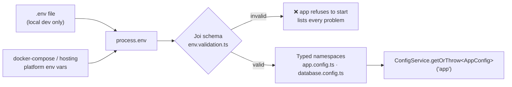

# 08 — Configuration

> Store config in the environment. — [The Twelve-Factor App](https://12factor.net/config)

Anything that differs between environments (ports, credentials, URLs, log level) is an
**environment variable**, never a hard-coded value. The same Docker image then runs in dev,
staging and production with different env vars.

## Backend

### Where values come from

1. **`.env`** — `@nestjs/config` loads `apps/api/.env` in local development. It is git-ignored.
   [`.env.example`](../apps/api/.env.example) is the committed, documented template:
   `cp .env.example .env`.
2. **Real environment variables** — in Docker/production, variables are set by compose or the
   hosting platform; they take precedence over `.env`.
3. **Validation** — [`env.validation.ts`](../apps/api/src/config/env.validation.ts) is a Joi
   schema. Required values (`DB_HOST`…) must be present; types and allowed values are checked;
   defaults are applied. With `abortEarly: false`, _all_ problems are reported at once.
4. **Namespaces** — [`app.config.ts`](../apps/api/src/config/app.config.ts) and
   [`database.config.ts`](../apps/api/src/config/database.config.ts) use `registerAs('app', …)`
   to turn flat strings into typed objects (numbers, booleans, `corsOrigins: string[]`) behind an
   interface.
5. **Consumption** — `config.getOrThrow<AppConfig>('app')`. Code never reads `process.env`
   directly (except inside `src/config/`).

**Why this matters in production:** a typo in a variable name or a missing password is caught in
the first second of deployment with a clear message — not hours later as a confusing runtime
error.

### Variables

| Variable            | Default                  | Description                                             |
| ------------------- | ------------------------ | ------------------------------------------------------- |
| `NODE_ENV`          | `development`            | `development` \| `production` \| `test`                 |
| `PORT`              | `3000`                   | HTTP port                                               |
| `CORS_ORIGINS`      | `http://localhost:5173`  | Comma-separated browser origins allowed to call the API |
| `LOG_LEVEL`         | `info`                   | `fatal` … `trace`, or `silent`                          |
| `SWAGGER_ENABLED`   | `true` unless production | Expose `/api/docs`                                      |
| `THROTTLE_TTL`      | `60000`                  | Rate-limit window (ms)                                  |
| `THROTTLE_LIMIT`    | `100`                    | Max requests per window per client                      |
| `DB_HOST`           | **required**             | Postgres host (`localhost` dev, `db` in compose)        |
| `DB_PORT`           | `5432`                   |                                                         |
| `DB_USERNAME`       | **required**             |                                                         |
| `DB_PASSWORD`       | **required**             |                                                         |
| `DB_NAME`           | **required**             |                                                         |
| `DB_SSL`            | `false`                  | Enable TLS to the DB (managed cloud databases)          |
| `DB_LOGGING`        | `false`                  | Log every SQL query (debugging only)                    |
| `DB_RUN_MIGRATIONS` | `true`                   | Apply pending migrations on startup                     |

### Adding a new variable (checklist)

1. Add it to the Joi schema with a type, default or `.required()`.
2. Map it into the right namespace interface + factory (or create a new namespace and add it to
   `load: [...]` in `app.module.ts`).
3. Document it in `.env.example`.
4. Add it to `docker-compose.yml` if the container needs it.
5. Read it via `ConfigService.getOrThrow`.

## Frontend

Vite exposes only variables prefixed **`VITE_`** to browser code, and **replaces them at build
time**. They are therefore public — **never put secrets in them**.

| Variable                    | Default                 | Description                              |
| --------------------------- | ----------------------- | ---------------------------------------- |
| `VITE_API_BASE_URL`         | `/api/v1`               | API base URL as seen by the browser      |
| `VITE_APP_NAME`             | `Tasks`                 | Display name (header, page titles)       |
| `VITE_DEV_API_PROXY_TARGET` | `http://localhost:3000` | Dev server only: where `/api` is proxied |

Files: `apps/web/.env` (git-ignored, local), [`.env.example`](../apps/web/.env.example), types in
[`env.d.ts`](../apps/web/env.d.ts), access only through
[`src/config/env.ts`](../apps/web/src/config/env.ts).

Vite also supports mode-specific files (`.env.development`, `.env.production`) if you need them.

In Docker, `VITE_API_BASE_URL` is a **build argument** (`ARG` in the web Dockerfile) because it
must be known when the bundle is built.

## Docker compose

[`docker-compose.yml`](../docker-compose.yml) sets the API's variables explicitly and uses
`${VAR:-default}` so you can override values from your shell or a root `.env` file:

| Variable                                | Default                     | Purpose                   |
| --------------------------------------- | --------------------------- | ------------------------- |
| `DB_USERNAME`, `DB_PASSWORD`, `DB_NAME` | `postgres`/`postgres`/`app` | Shared by db and api      |
| `WEB_PORT`                              | `8080`                      | Host port for the web app |
| `API_PORT`                              | `3000`                      | Host port for the API     |
| `DB_HOST_PORT`                          | `5432`                      | Host port for Postgres    |

Example: `WEB_PORT=8081 docker compose up -d`.

## Secrets in real production

`.env` files are fine locally. In production, inject secrets from a **secret manager**
(GitHub Actions secrets, AWS Secrets Manager, GCP Secret Manager, Vault, Kubernetes Secrets,
or your PaaS's environment settings). Rules:

- Never commit real secrets. `.gitignore` excludes `.env*` except `.env.example`.
- Never bake secrets into Docker images (`.dockerignore` excludes `.env` files).
- Use different credentials per environment and rotate them.
- The default `postgres/postgres` credentials are for local use only.
