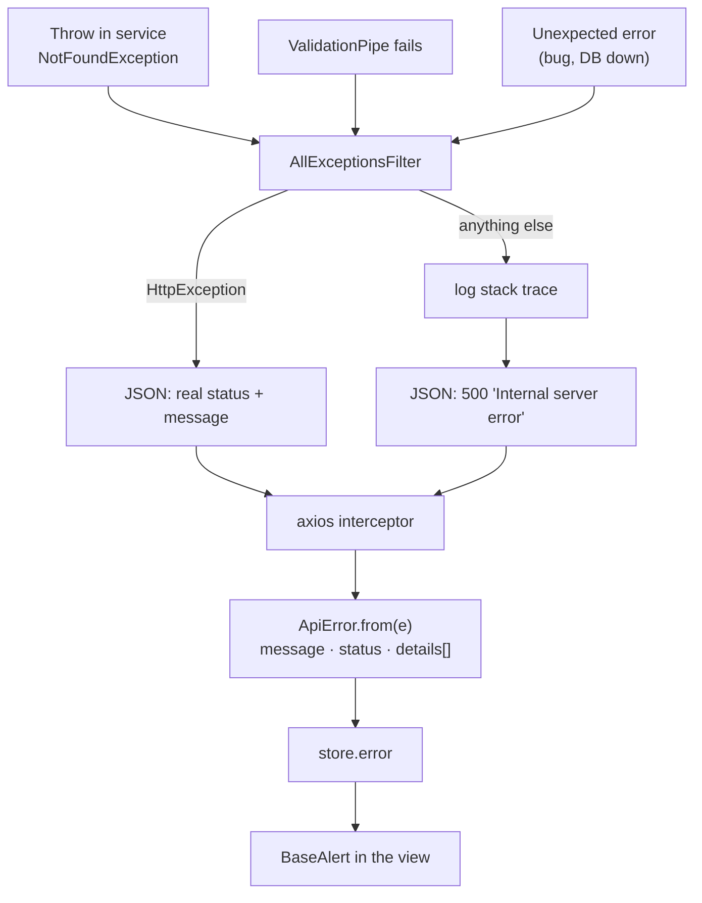

# 10 — Observability: logging, health checks, error handling

**Observability** = being able to tell what your system is doing in production from the outside.
The three classic pillars are **logs**, **metrics** and **traces**. This template implements
logs and health checks, and shows where metrics/tracing would plug in.

## 1. Structured logging with pino

Configured in [`app.module.ts`](../apps/api/src/app.module.ts) via `nestjs-pino`:

```ts
pinoHttp: {
  level: app.logLevel,
  redact: ['req.headers.authorization', 'req.headers.cookie'],
  autoLogging: { ignore: (req) => req.url?.includes('/health') ?? false },
  transport: app.isProduction ? undefined
    : { target: 'pino-pretty', options: { singleLine: true, colorize: true } },
},
forRoutes: [{ path: '{*path}', method: RequestMethod.ALL }],
```

**Structured** means each log line is a JSON object, not free text:

```json
{
  "level": 30,
  "time": 1795032143953,
  "pid": 1,
  "req": { "id": 1, "method": "POST", "url": "/api/v1/tasks" },
  "res": { "statusCode": 201 },
  "responseTime": 12,
  "msg": "request completed"
}
```

Why it matters: log platforms (Datadog, Grafana Loki, ELK, CloudWatch) can **filter and
aggregate** on fields — e.g. "all 5xx responses slower than 500 ms on `/api/v1/tasks`".

| Feature                | Detail                                                               |
| ---------------------- | -------------------------------------------------------------------- |
| Automatic request logs | Every request: method, URL, status, response time, request id        |
| Levels                 | `LOG_LEVEL` (`debug` locally, `info` in production)                  |
| Redaction              | Auth headers and cookies are replaced by `[Redacted]`                |
| Noise reduction        | Health-check calls are not logged                                    |
| Dev experience         | `pino-pretty` prints colourised single lines in development only     |
| stdout only            | Logs go to stdout; Docker/the platform collects them (Twelve-Factor) |

Logging inside your code:

```ts
private readonly logger = new Logger(TasksService.name);
this.logger.log('Task created');          // info
this.logger.warn({ id }, 'Slow query');   // structured fields
```

Never use `console.log` in the API, and never log secrets or personal data.

## 2. Health checks

[`health.controller.ts`](../apps/api/src/modules/health/health.controller.ts) uses
`@nestjs/terminus`:

```ts
@Get() @HealthCheck()
check() { return this.health.check([() => this.db.pingCheck('database', { timeout: 1500 })]); }
```

`GET /api/health` → `200 {"status":"ok",…}` or `503` when the DB is unreachable. Consumers:

- **Docker `HEALTHCHECK`** in the API Dockerfile calls it every 30 s.
- **docker compose** waits for `api` to be healthy before starting `web`
  (`depends_on: condition: service_healthy`).
- In Kubernetes or a cloud load balancer it would back **liveness/readiness probes**: unhealthy
  instances are restarted or removed from rotation.

## 3. Error handling end to end



Backend ([`all-exceptions.filter.ts`](../apps/api/src/common/filters/all-exceptions.filter.ts)):
`@Catch()` with no argument catches **everything**. Known HTTP exceptions keep their status and
message; anything else is logged with its stack and returned as a generic 500 — clients never see
internals.

Frontend: [`ApiError`](../apps/web/src/services/http/api-error.ts) normalises network errors,
timeouts and API error bodies into one type. Stores catch, set `error`, re-throw; views render
`error.message` (and `error.details` for validation lists). Uncaught component errors go to
`app.config.errorHandler` in `main.ts` — the place to hook an error tracker.

## 4. What you'd add next

| Need                | Typical tool                                                                                                               |
| ------------------- | -------------------------------------------------------------------------------------------------------------------------- |
| Error tracking      | **Sentry** (`@sentry/nestjs`, `@sentry/vue`) — wire into the filter and `errorHandler`                                     |
| Metrics             | **Prometheus** (`@willsoto/nestjs-prometheus`) + Grafana dashboards: request rate, error rate, latency (the "RED" metrics) |
| Distributed tracing | **OpenTelemetry** SDK → Jaeger/Tempo/Datadog; follow one request across services                                           |
| Request correlation | Propagate an `X-Request-Id` header from nginx through pino (`genReqId`)                                                    |
| Uptime monitoring   | External pinger on `/api/health` (UptimeRobot, Better Stack)                                                               |
| Alerting            | Alerts on error-rate and latency thresholds, not on single errors                                                          |
