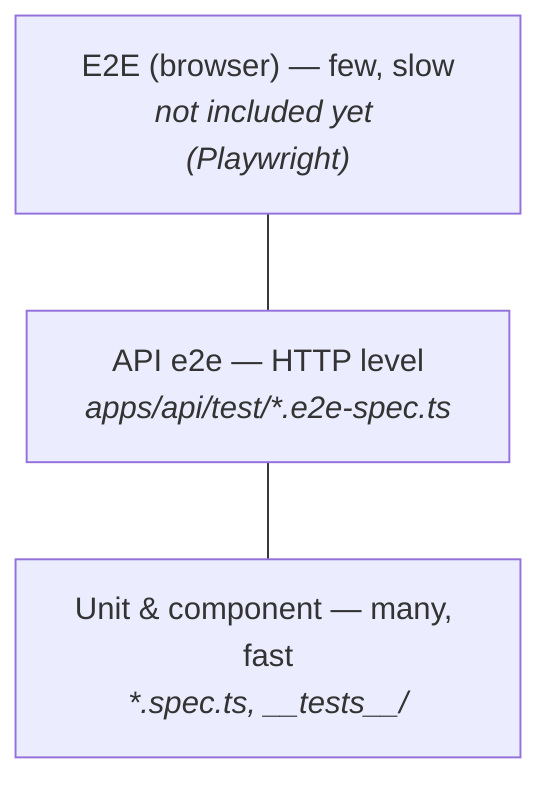

# 11 — Testing

## 1. Strategy: the test pyramid



- **Many fast unit tests** check logic in isolation (milliseconds each).
- **Fewer integration/e2e tests** check that pieces work together through real HTTP.
- **Very few full browser tests** for critical user journeys (next step to add).

Current suite: **28 tests** — API unit 11, API e2e 6, web 11.

| Command                      | Runs                               |
| ---------------------------- | ---------------------------------- |
| `npm test`                   | All unit tests (both apps)         |
| `npm run test:e2e`           | API e2e tests                      |
| `npm run test:watch -w <ws>` | Re-run on save                     |
| `npm run test:cov -w <ws>`   | With coverage report (`coverage/`) |

## 2. Backend unit tests (Jest)

Jest config lives in [`apps/api/package.json`](../apps/api/package.json) (`rootDir: src`,
`*.spec.ts`, `ts-jest` transform). Specs sit **next to** the code they test.

### Service test — mock the repository

[`tasks.service.spec.ts`](../apps/api/src/modules/tasks/tasks.service.spec.ts):

```ts
repo = { findAndCount: jest.fn(), findOneBy: jest.fn(), create: jest.fn(...), save: jest.fn(...), ... };

const moduleRef = await Test.createTestingModule({
  providers: [TasksService, { provide: getRepositoryToken(Task), useValue: repo }],
}).compile();
service = moduleRef.get(TasksService);

it('returns paginated tasks with correct skip/take', async () => {
  repo.findAndCount.mockResolvedValue([tasks, 21]);
  const result = await service.findAll({ page: 3, limit: 10 });
  expect(repo.findAndCount).toHaveBeenCalledWith(expect.objectContaining({ skip: 20, take: 10 }));
  expect(result.meta).toEqual({ page: 3, limit: 10, total: 21, totalPages: 3 });
});
```

`Test.createTestingModule` builds a mini Nest module, so DI works exactly like in the app — we
just swap the repository for a fake under the same token. A `buildTask(overrides)` **factory**
keeps test data short and readable.

### Controller test — mock the service

[`tasks.controller.spec.ts`](../apps/api/src/modules/tasks/tasks.controller.spec.ts) checks the
controller delegates correctly. It's small because controllers are thin.

## 3. Backend e2e tests (Jest + Supertest)

[`tasks.e2e-spec.ts`](../apps/api/test/tasks.e2e-spec.ts) boots a real Nest application and sends
real HTTP requests:

```ts
const moduleRef = await Test.createTestingModule({
  imports: [
    ConfigModule.forRoot({ isGlobal: true, ignoreEnvFile: true, load: [appConfig] }),
    TasksModule,
  ],
})
  .overrideProvider(getRepositoryToken(Task))
  .useValue(repository) // in-memory fake
  .compile();

app = moduleRef.createNestApplication();
setupApp(app); // SAME pipeline as production
await app.init();

await request(app.getHttpServer()).post('/api/v1/tasks').send({ title: '' }).expect(400);
```

What makes this design good:

- **`setupApp(app)`** — tests run the exact global prefix, versioning, validation and error filter
  used in production. A test proves `/api/v1/tasks` returns our error shape, not just that a
  method works.
- **In-memory repository** ([`in-memory-task.repository.ts`](../apps/api/test/utils/in-memory-task.repository.ts))
  — no database needed, so tests are fast and run anywhere (including CI) without Docker.
- Covered: create (with trimming), validation errors + unknown fields, pagination, bad UUID (400),
  unknown id (404), update then delete.

**Trade-off:** the fake doesn't prove the real SQL works. A next step is a separate suite against
a real Postgres using **Testcontainers** or the CI `services:` feature.

## 4. Frontend tests (Vitest + Vue Test Utils)

[`vitest.config.ts`](../apps/web/vitest.config.ts) reuses the Vite config (so the `@` alias and
Vue plugin work) and uses `jsdom` to simulate a browser.

### Component test

[`TaskForm.spec.ts`](../apps/web/src/features/tasks/__tests__/TaskForm.spec.ts):

```ts
const wrapper = mount(TaskForm, { global: { stubs: { RouterLink: RouterLinkStub } } });
await wrapper.find('input[type="text"]').setValue('  Buy milk  ');
await wrapper.find('form').trigger('submit');
expect(wrapper.emitted('submit')?.[0]).toEqual([
  { title: 'Buy milk', description: null, status: 'todo', dueDate: null },
]);
```

We test **behaviour the user/parent sees** — rendered text, emitted events — not internal
variables. `RouterLink` is stubbed because no router is installed in the test.

### Store test

[`tasks.store.spec.ts`](../apps/web/src/features/tasks/__tests__/tasks.store.spec.ts):

```ts
vi.mock('../api/tasks.api', () => ({ tasksApi: { list: vi.fn(), ... } }));
beforeEach(() => { setActivePinia(createPinia()); vi.resetAllMocks(); });

api.list.mockRejectedValue(new ApiError('Boom', 500));
await expect(store.fetchTasks()).rejects.toBeInstanceOf(ApiError);
expect(store.error?.message).toBe('Boom');
```

The API module is mocked at the **boundary**, so the store's own logic (state updates, error
handling, pagination step-back) is tested without HTTP.

## 5. Rules of thumb

- Arrange → Act → Assert; one behaviour per test; test names read as sentences.
- Mock at boundaries (repository, API module), not internal functions.
- Reset mocks between tests; no shared mutable state.
- Every bug fix starts with a failing test that reproduces it.
- Never `.skip` or weaken a test to get green.

## 6. Next steps

| Add                       | Tool                                                            |
| ------------------------- | --------------------------------------------------------------- |
| Browser end-to-end tests  | **Playwright** against `docker compose up`                      |
| Real-DB integration tests | **Testcontainers** for Postgres                                 |
| Coverage thresholds in CI | Jest `coverageThreshold`, Vitest `coverage.thresholds`          |
| Contract tests            | Generate web types from the OpenAPI spec (`openapi-typescript`) |
