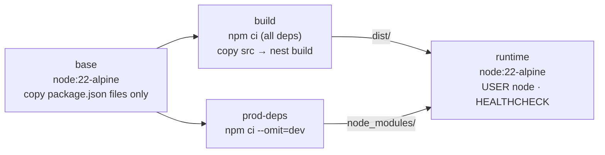
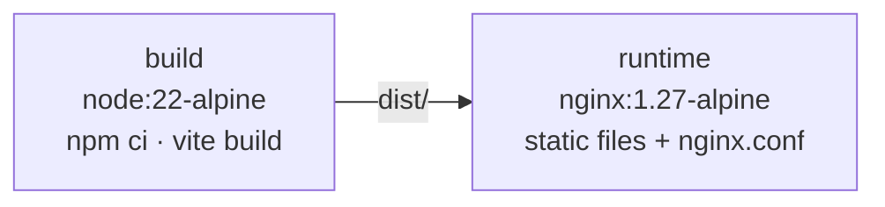
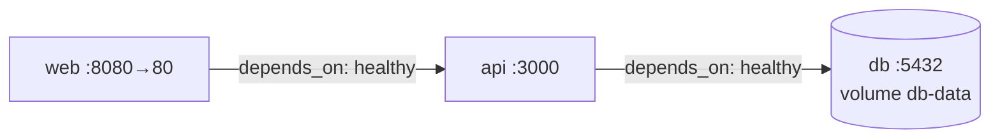

# 13 — Docker & deployment

## 1. Why containers

A **Docker image** packages an app with its exact runtime (Node version, OS libraries,
dependencies). A **container** is a running instance of an image. Benefits:

- "Works on my machine" disappears — the same image runs locally, in CI and in production.
- Each service is isolated with its own dependencies.
- Deploying = shipping an image; rolling back = running the previous image.

Key vocabulary: **Dockerfile** (recipe), **layer** (each instruction produces a cached layer),
**build context** (files sent to the builder), **volume** (persistent storage), **network**
(compose services reach each other by service name, e.g. `db`).

## 2. Build context = repository root

Both Dockerfiles are built from the **repo root** (`context: .` in compose) because npm
workspaces have a single root `package-lock.json`. [`.dockerignore`](../.dockerignore) keeps the
context small and safe: no `node_modules`, `dist`, `.env`, `.git`, tests.

## 3. API image — [`apps/api/Dockerfile`](../apps/api/Dockerfile)

A **multi-stage build**: earlier stages have compilers and dev tools; the final image only
contains what's needed to run.



| Stage       | What it does                                                                              | Why                                                                                               |
| ----------- | ----------------------------------------------------------------------------------------- | ------------------------------------------------------------------------------------------------- |
| `base`      | Copies **only** `package.json` + lockfile (all workspaces)                                | Dependency layers are cached until manifests change, so code edits don't trigger a full reinstall |
| `build`     | `npm ci --workspace @app/api …`, copies source, `nest build`                              | Compiles TypeScript with dev dependencies available                                               |
| `prod-deps` | `npm ci --omit=dev`                                                                       | Production dependencies only (no Jest, ESLint, TypeScript…)                                       |
| `runtime`   | Copies `node_modules` + `dist`, `USER node`, `HEALTHCHECK`, `CMD ["node","dist/main.js"]` | Small, non-root, self-monitoring                                                                  |

Details worth noticing:

- **`npm ci`** (not `npm install`) installs _exactly_ the lockfile versions and fails if they
  disagree — reproducible builds.
- `--ignore-scripts` skips package install scripts (smaller attack surface; none are needed).
- `ENV NODE_ENV=production` enables production behaviour in libraries.
- **`CMD ["node", …]`** in exec form: Node is PID 1 and receives `SIGTERM` directly, so
  `enableShutdownHooks()` can close DB connections gracefully. (Running via `npm start` would
  swallow the signal.)
- **`HEALTHCHECK`** uses `wget` (present in Alpine) against `/api/health`.

Result: ~85 MB compressed, versus 400+ MB if you shipped the build stage.

## 4. Web image — [`apps/web/Dockerfile`](../apps/web/Dockerfile)



- `ARG VITE_API_BASE_URL=/api/v1` — build-time variable baked into the bundle.
- The final image contains **no Node.js at all**, only nginx + static files (~21 MB).

## 5. nginx — [`apps/web/nginx.conf`](../apps/web/nginx.conf)

| Block               | Purpose                                                                                                                      |
| ------------------- | ---------------------------------------------------------------------------------------------------------------------------- |
| `gzip on …`         | Compress text assets                                                                                                         |
| `location /api/`    | **Reverse proxy** to `http://api:3000` with `X-Forwarded-*` headers. Browser sees one origin → no CORS                       |
| `location /assets/` | Vite's content-hashed files: `Cache-Control: public, max-age=31536000, immutable` (cache 1 year)                             |
| `location /`        | `try_files $uri $uri/ /index.html` (**SPA fallback**) and `Cache-Control: no-cache` so new deploys are picked up immediately |
| Security headers    | `X-Content-Type-Options`, `X-Frame-Options`, `Referrer-Policy`; `server_tokens off`                                          |

**Gotcha:** nginx's `add_header` is _not inherited_ by a `location` that defines its own
`add_header`. That's why security headers are repeated per location.

## 6. docker compose — [`docker-compose.yml`](../docker-compose.yml)



| Service | Image / build         | Notable config                                                                     |
| ------- | --------------------- | ---------------------------------------------------------------------------------- |
| `db`    | `postgres:16-alpine`  | `POSTGRES_*` env, `pg_isready` healthcheck, named volume `db-data` for persistence |
| `api`   | `apps/api/Dockerfile` | Full env block, `DB_HOST: db` (service name = hostname), runs migrations on boot   |
| `web`   | `apps/web/Dockerfile` | Starts only when the API is healthy                                                |

- `restart: unless-stopped` — containers come back after crashes or Docker restarts.
- `depends_on: condition: service_healthy` — proper startup ordering (not just "started").
- `${VAR:-default}` — overridable values (`WEB_PORT`, `API_PORT`, `DB_HOST_PORT`, DB credentials).

## 7. Commands

```bash
docker compose up -d --build     # build images and start everything (npm run docker:up)
docker compose ps                # status + health
docker compose logs -f api       # follow API logs
docker compose exec db psql -U postgres -d app   # SQL shell
docker compose down              # stop & remove containers (data kept)
docker compose down -v           # ALSO delete the database volume
npm run db:up                    # only Postgres, for local dev with npm run dev
docker images                    # image sizes
```

## 8. Going to real production

Compose on one server is a valid start for small apps. Typical next steps:

1. **Push images to a registry** (GitHub Container Registry, Docker Hub, ECR) from CI, tagged with
   the Git SHA.
2. **Run them on a platform**: a VPS with compose, a PaaS (Render, Fly.io, Railway), a managed
   container service (AWS ECS/Fargate, Google Cloud Run, Azure Container Apps) or Kubernetes.
3. **Managed PostgreSQL** (RDS, Cloud SQL, Neon, Supabase) with backups and `DB_SSL=true`,
   instead of a DB container.
4. **TLS/HTTPS** at a load balancer or reverse proxy (Caddy, Traefik, cloud LB).
5. **Secrets** from the platform's secret manager.
6. Only the web/proxy port public; API and DB on a private network.
7. **Zero-downtime deploys**: rolling updates gated by the health check.
