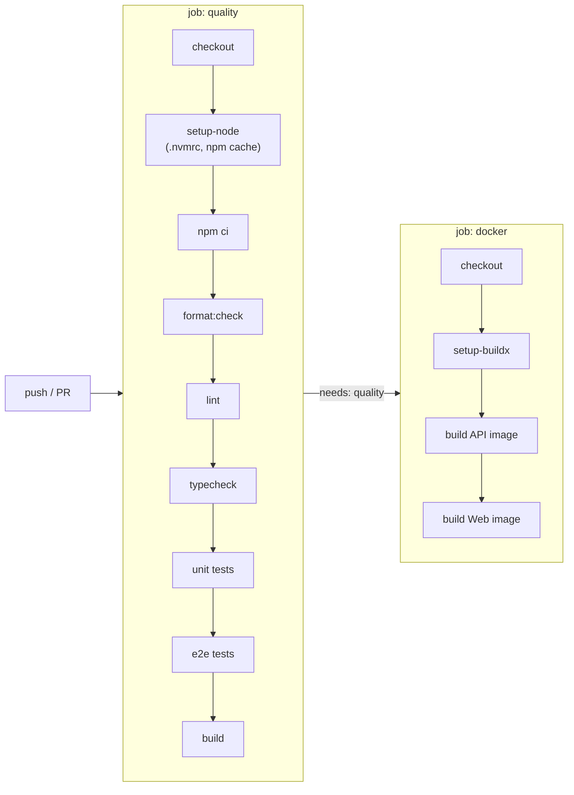

# 14 — CI/CD (GitHub Actions)

- **CI — Continuous Integration:** every push/PR is automatically checked (lint, types, tests,
  build). Broken code is caught before merge.
- **CD — Continuous Delivery/Deployment:** passing builds are automatically packaged and
  released. This repo implements CI and builds the Docker images; publishing/deploying is the
  next step (see below).

## The workflow — [`.github/workflows/ci.yml`](../.github/workflows/ci.yml)

```yaml
on:
  push: { branches: [main] }
  pull_request:
concurrency:
  group: ci-${{ github.ref }}
  cancel-in-progress: true
```

- Runs on pushes to `main` and on every pull request.
- **concurrency** cancels an older run on the same branch when you push again — saves minutes.



### Job `quality`

| Step                                                                  | Why                                                                              |
| --------------------------------------------------------------------- | -------------------------------------------------------------------------------- |
| `actions/setup-node` with `node-version-file: .nvmrc`                 | CI uses the same Node version as developers                                      |
| `cache: npm`                                                          | Re-uses the npm download cache between runs                                      |
| `npm ci`                                                              | Clean, lockfile-exact install                                                    |
| `format:check` → `lint` → `typecheck` → `test` → `test:e2e` → `build` | Exactly the local Definition of Done. Cheapest checks first so failures are fast |

The e2e tests use an in-memory repository, so **no database service** is required in CI.

### Job `docker`

`needs: quality` — only runs if quality passed. Builds both images with Buildx (`push: false`) to
prove the Dockerfiles still work. A Dockerfile broken by a dependency change is caught on the PR,
not at deploy time.

## Protecting `main` (recommended GitHub settings)

In **Settings → Branches → Add rule** for `main`:

- Require a pull request before merging (and optionally 1 approval).
- Require status checks to pass: `Lint · Typecheck · Test · Build` and `Docker images`.
- Require branches to be up to date before merging.
- Block force pushes.

Then nothing reaches `main` without passing CI — the core promise of CI.

## Extending to CD (next steps)

1. **Publish images** on pushes to `main`:
   ```yaml
   - uses: docker/login-action@v3
     with: { registry: ghcr.io, username: ${{ github.actor }}, password: ${{ secrets.GITHUB_TOKEN }} }
   - uses: docker/build-push-action@v6
     with:
       context: .
       file: apps/api/Dockerfile
       push: true
       tags: ghcr.io/${{ github.repository }}/api:${{ github.sha }}
   ```
   (add `permissions: packages: write` to the job).
2. **Deploy** — trigger your platform (SSH + `docker compose pull && up -d`, a PaaS deploy hook,
   or Kubernetes manifests via Argo CD).
3. **Environments** — GitHub Environments (`staging`, `production`) with required reviewers and
   environment-specific secrets.
4. **Dependency updates** — enable Dependabot or Renovate so dependency bumps arrive as PRs that
   CI validates.
5. **Security scanning** — CodeQL, `npm audit`, Trivy on images.
